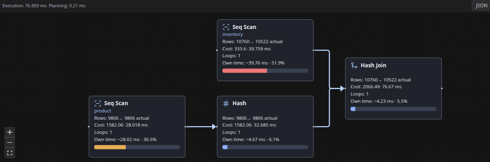
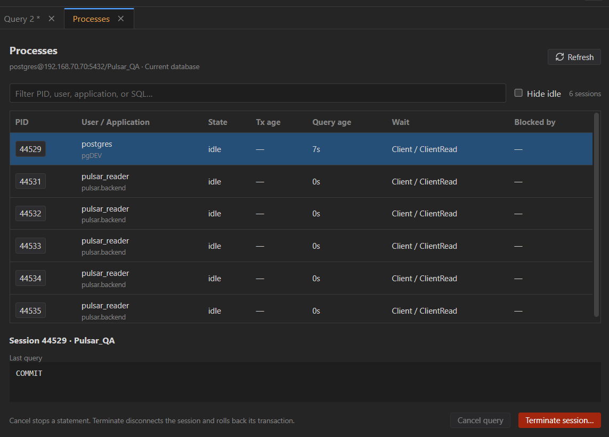

**pgDEV** is an IDE for PostgreSQL, built around productivity, simplicity, and a smooth developer experience.

It integrates with the AI coding harness of your choice, bringing AI-assisted development directly into your PostgreSQL workflow.

# 1. Start

Download the installer for your platform from [GitHub Releases](https://github.com/pankleks/pgdev/releases):

| Platform | Build |
| --- | --- |
| Windows | x64 installer (`-setup.exe`) or portable (`-portable.exe`, state in `pgDEV-data/` next to the exe) |
| macOS | Apple Silicon / arm64 (`.dmg` or `.zip`) |
| Linux | x64 (`.deb` or `.rpm`) |

Install and open **pgDEV**. You need a PostgreSQL server (14 or newer), but **not Node.js, npm, or a separate browser**. Preview builds may be unsigned; signed public releases require the project's signing credentials.

The database service runs inside an isolated Electron utility process. Closing pgDEV saves the editor session, stops queries and rolls back open transactions. Application updates are manual initially.

> Click **Not connected** to setup first connection.

# 2. Connections

Parameters or a `postgres://…` connection string, with optional SSL. Connections persist on this device and can auto-connect on startup. The dialog manages the saved set — reuse, forget, or disconnect:

Give each saved profile a unique **Connection name** (case-insensitive; whitespace is trimmed). Leave it blank to use the generated connection label. Profiles may share the same connection details under different names. Select a profile and use **Save changes** to update it, or change its name and use **Save as new** to save a separate profile from the current fields. **New connection** only opens a fresh form. Saving does not connect or switch databases; **Connect** opens a session and also saves the profile when **Remember on this device** is checked. The badge shows the active profile's name. Connection numbers and `?connect=N` links are no longer supported; normal startup still reconnects to the last connection.

# 3. Object browser

Section headers carry object counts; expansion survives reload; the refresh button re-reads the schema from the server.

* **Tables** — Columns (name, type, nullability), Indexes, Constraints (PK / FK / unique / check), Triggers.
* **Views** — columns. **Functions** — parameters plus return type, overloads listed separately. **Sequences** — increment, start, type, ownership. **Types** — composite/enum detail rows.
* Prefix grouping for related objects (Settings → *Group objects*).
* Right-click: **Collapse** on parents, **Edit…** on editable tables (section 8). Double-click opens DDL (section 5); double-clicking the empty tab strip opens a fresh query tab.

# 4. Search

One box filters every section; matching is case-insensitive with per-section counters (`Tables 2/4`) and highlighted hits:

* Spaces are OR (`employee labor`), `+` is AND (`employee+labor`), `"quotes"` are exact.
* A leading/trailing word scopes the kind: `table`, `view`, `function` (`func`, `fn`), `column` (`col`), `parameter` (`param`), `type`, `sequence` (`seq`) — e.g. `fn count`, `col id`. Parameter *names* match (`p_emp` finds its function); argument *types* never do (`integer` matches nothing).
* While filtering, sections force-open and group collapse goes inert; no hits reports `No objects match "…"`.

# 5. DDL tabs

Double-click generates a script built to re-apply verbatim — full `CREATE TABLE` with columns, constraints, indexes and ownership:

Tables, plain views, sequences and functions open **editable**; materialized views open **read-only** as a preview.

# 6. Execution model

`F5` / `Ctrl+Enter` runs the selection if there is one, else the tab. Completions are schema-driven (user objects plus built-ins once typed, never `pg_`-internals), with hover docs and signature help.

* Multi-statement batches run with per-statement result sets; typed column headers, `COPY`/`CSV` export, `N row(s)` footer. Failures land in **Messages**, never as a grid.
* **RUN ▾ → Run on multiple connections** — select SQL in an unbound query tab, choose saved profiles in the checkbox dialog, then run. The last selection is remembered across restarts and profile renames. Results are grouped by profile, with independent messages, cancellation, paging and export; one failure does not stop the other targets. This uses separate sessions without switching the active connection. SQL may modify every selected database: execution is **not atomic across connections**. Close the grouped results to release those sessions (open transactions roll back).
* Double-click a cell to inspect its raw value (pretty-printed for JSON/JSONB, with a character count) — the dialog's COPY button is the copy path, and a successful copy closes it.
* Large results load in pages without holding transactions or locks between clicks. “Load more” reruns the SELECT and skips previously loaded rows; concurrent changes can cause skipped or duplicated rows. Use a stable `ORDER BY`. “Load all” fetches every remaining page (in pages of 5,000) up to 100,000 rows; use Export CSV for larger results. “Cancel load” stops it. Each page may rerun expensive work; later pages are read-only and cannot repeat database writes from SELECT functions. Explicit `BEGIN` transactions remain open until you finish them.
* Statement timeout (configurable, applies to new connections) plus explicit cancellation bound runaway queries.
* **Execution plans** — **RUN ▾ → Explain / Explain Analyze**. Analyze executes the SQL to measure it and then rolls its changes back; inside your own open transaction they stay until you COMMIT or ROLLBACK. Effects outside the transaction (sequence values, external calls) are not undone. Clicking **RUN** directly keeps normal execution; F5 / Ctrl+Enter is unchanged.

  

* Manual transactions can span runs with transaction-id pinning — a conflicting tab gets a 409 rather than joining the wrong transaction. Statements requiring autocommit (`VACUUM`, …) bypass the transaction path.
* Run stays disabled while disconnected, while a query is in flight, or in the read-only `AI` log tab.

# 7. Row editor

Edit pencils appear only when the result carries the table's primary key (`SELECT label FROM …` has none). The dialog locks the key, offers per-type editors with NULL checkboxes where allowed, and keeps SAVE disabled until the first change:

Next to the pencil, each row has **Duplicate** and **Delete**, and the grid footer has **Add row**:

* **Add row** and **Duplicate** open the same dialog as a new row, with a **DEFAULT** checkbox per column. A checked column is left out of the `INSERT`, so identity, serial and `DEFAULT` values come from the database. A blank row starts on DEFAULT wherever the column has a default or allows NULL. A duplicate copies the row's values (unchanged values are sent exactly as read) but leaves a key with a default to the database, so the copy gets a fresh key. Generated and `bytea` columns are never written.
* **Delete** asks for confirmation, then deletes exactly that row by its full primary key (`DELETE … WHERE <key> RETURNING *`).
* Like edits, inserts and deletes run inside the tab's open transaction when there is one (your COMMIT/ROLLBACK decides), otherwise they commit immediately. New rows appear at the end of the loaded rows.

Invalid input (e.g. malformed JSON) is rejected client-side; server rejections (e.g. numeric overflow) arrive in-dialog with the PostgreSQL message — either way the dialog stays open and nothing is lost. A successful save runs a parameterized `UPDATE … RETURNING` and patches the grid from the returned row.

# 8. Table editor

Right-click → **Edit…** covers ordinary and partitioned-parent tables only (partitions inherit shape; foreign tables speak a different DDL):

Rename, retype (length/precision/scale), nullability, defaults, add/drop columns, table/column comments. **Generate DDL** emits only the changed `ALTER` clauses in apply-safe order (drops → renames → alters → adds → comments) for review. No-ops, locked/PK columns and stale fingerprints (409) are refused with an explanation.

# 9. Helpers

* **Processes** — inspect sessions, cancel queries, or terminate connections.

  

* `Ctrl+Shift+F` formats the selection, or the whole tab when nothing is selected.
* The sliders action builds a `PREPARE` / `EXECUTE` template from `$N` parameters; optional values ride along as a JSON array (e.g. `[1, "text", null]`).
* Tab sessions (open tabs, pinned files) restore across reloads.

# 10. Settings and AI agent (MCP)

Settings are per-device: editor font size, statement timeout for new connections, object grouping by name prefix, and the AI row/size caps. **Reset to defaults** restores everything.

Settings, pinned file references and tab sessions use versioned JSON snapshots in Electron's application-data directory, with atomic replacement and backups. Database credentials use OS-backed encryption; on Linux without a secure keyring, passwords are not persisted. IndexedDB and browser-data migration are not used.

## MCP access

pgDEV exposes an MCP server.

The AI dialog provides a copyable configuration pointing at the bundled **pgdev-mcp** executable. The helper needs no system Node installation and authenticates to the running app with a separate persistent token. It discovers the current loopback port through a native endpoint file, so the configuration survives app restarts. Before sending the token, the helper checks that the server really is this pgDEV launch, so a stale endpoint left by a crash cannot hand the token to another local process. Keep the token private; if it may have leaked, use **Rotate** next to the MCP config in Settings → AI agent. The old token stops working immediately, and the new config is copied for you to paste into each MCP client.

What the agent's `query` can do:

* It runs one statement at a time in a read-only transaction that is always rolled back, so it cannot change data or schema.
* Calls with effects outside that transaction are refused: signalling or terminating sessions, reading or writing server files, `dblink`, resetting statistics, replication management and `set_config`.
* This refusal only catches direct calls. An existing function can still reach them, so the reliable limit is the role's privileges.
* Set **Agent role** in the connect dialog to make agent queries run as a lower-privilege role (`SET LOCAL ROLE`; the login must be a member). Alternatively, connect with a low-privilege login.
* `get_schema` and `get_ddl` read the catalog with the connection's own login.

Closing pgDEV also stops its MCP helpers so they do not block Windows updates. After reopening pgDEV, reconnect MCP in your client; the saved configuration remains valid.

Read tools: `query`, `get_schema` (optional `schema`/`table` filters; relation lists truncate past 200 entries), `get_ddl` (`type`/`schema`/`name`, plus `oid`/`parent` to pin overloads and constraints), `get_active_result` (the active tab's grids capped like `query`, plus the last 100 Messages lines — so the agent sees the outcome, including errors, of scripts *you* ran; no database access happens here). Editor tools: `get_active_query`, `set_active_query` (`replace`/`append`/`insert`), `open_query_tab`, `list_tabs`, `activate_tab`, `close_tab`.

`get_active_result` includes `connectionId`, `profileId` and `connectionName` for the result source (`null` when unknown). For multi-connection runs it reads only the selected connection group. This does **not** change where `query`, `get_schema` or `get_ddl` execute: they still use the main active connection, which may differ from the displayed result's source.
